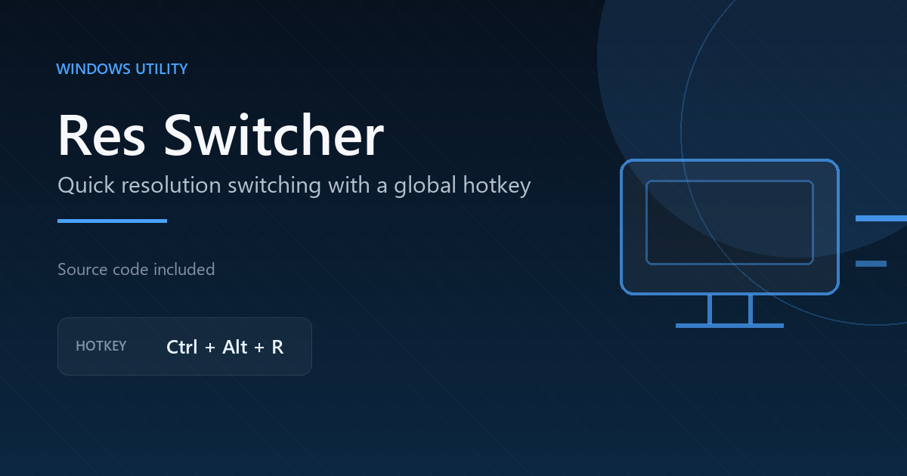

# Res Switcher

Small Windows tray app for switching a monitor between two resolutions with a hotkey.



## What it does

* Finds the monitors connected to your PC
* Lets you pick a monitor
* Lets you pick two resolutions
* Lets you record a hotkey
* Switches between the two resolutions when you press the hotkey
* Stays in the system tray after you save

## Run it

1. Install Python 3 for Windows.
2. Open a terminal in this folder.
3. Install the packages:

```bat
pip install keyboard pywin32 pillow pystray
```

4. Run:

```bat
pythonw res_switcher.pyw
```

You can also double click `res_switcher.pyw` if Python is set up for it.

The settings window opens the first time. After you save, the app runs in the tray.

## Notes

The app writes `res_settings.json` in the same folder when you save your setup. That file is ignored by the root `.gitignore` and should not be uploaded.

It uses Windows display APIs through `pywin32`. It does not call the internet or send your screen info anywhere.

Windows only. Some resolutions only work if the monitor and cable support them.
